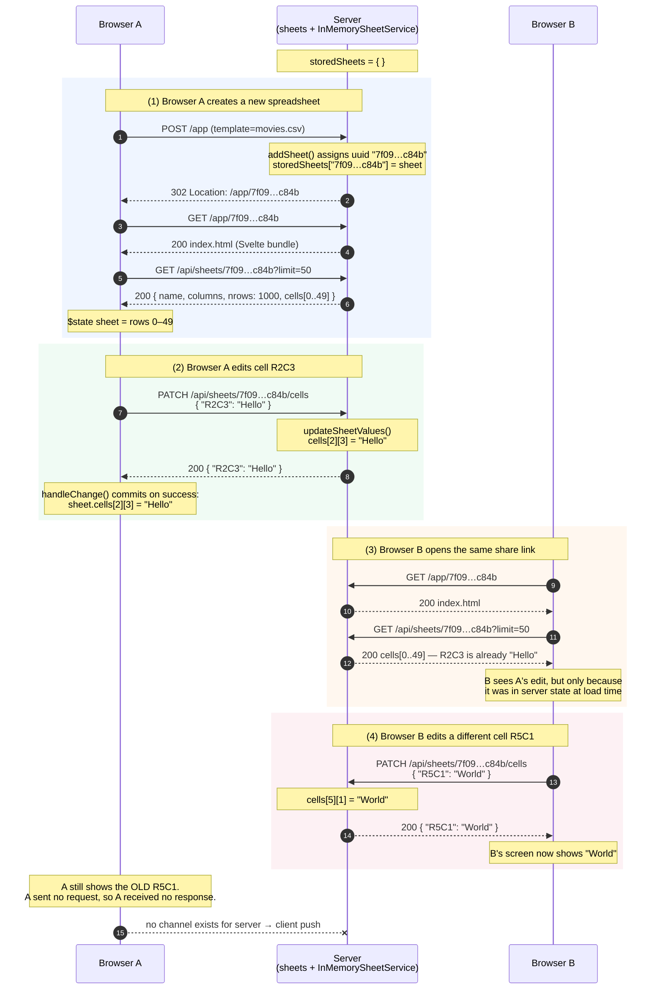

# Increment 3 Analysis — User Interactions

CSC 3001 | Modern Application Development | Fall 2026 | Group 7

## The question

Two browsers share a spreadsheet link. Both load the same data. But when one makes a
change, only that browser sees it; the other keeps showing stale data until the user
reloads the page. Why?

## Sequence diagram

## Why is Browser A's data not updated, while Browser B's was?

Browser B looked "up to date" for a reason that has nothing to do with live
synchronization: **B loaded after A's edit.** The `GET /api/sheets/:id?limit=50`
that B issued in step 3 was answered from the server's authoritative
`storedSheets`, which by then already contained `R2C3 = "Hello"`. B received a
*snapshot taken at load time*, not a live feed. Had A edited a cell after step 3,
B would be exactly as stale as A is now.

Browser A is stale for three compounding reasons:

1. **HTTP is strictly request/response, and only the client may initiate.** The
   server can only put bytes on a connection that a client already opened. After
   responding `200` to A's PATCH, the server has no open channel back to A. It
   cannot volunteer "by the way, R5C1 changed."

2. **The server keeps no list of interested clients.** `InMemorySheetService`
   stores sheets keyed by id — nothing more. It has no idea that Browser A exists,
   let alone that A is currently viewing sheet `7f09…c84b`. Even with a push
   mechanism available, it would not know whom to notify.

3. **Svelte reactivity is local and one-way.** `sheet` is a `$state` rune. The DOM
   re-renders when that state changes, and in `App.svelte` the only things that
   ever change it are A's own `fetch` calls: the initial `$effect`, `loadMoreRows`,
   and the success branch of `handleChange`. No request means no state change,
   which means no re-render. Reloading the page re-runs the `$effect`, which is
   why Ctrl/Cmd-R makes the new data appear.

In short: the browser holds a **cache**, the server holds the **truth**, and this
architecture has no cache-invalidation path. The two only reconcile when the client
decides to ask again.

## What would you change about the architecture?

The missing capability is **server-initiated notification**. The server must track
which clients are viewing which sheet, and on every successful
`updateSheetValues` broadcast the patch to every other viewer of that sheet. Each
receiving client then applies the patch to `sheet.cells` exactly the way
`handleChange` applies its own successful response — so the same reactive
re-render path is reused.

## Is it possible using HTTP? Or should we use another protocol?

**It is possible with HTTP, in three ways, with real trade-offs:**

| Approach | How it works | Trade-off |
|---|---|---|
| **Short polling** | Client re-requests `/api/sheets/:id` every N seconds | Simplest; still pure request/response. Wasteful — almost every request returns "nothing changed" — and update latency is up to N seconds. Cost scales with clients × poll rate, not with edits. |
| **Long polling** | Client sends a request the server holds open until a change occurs, then answers and the client immediately re-requests | Near-real-time over plain HTTP, but ties up a connection and a server handler per viewer, and needs careful timeout/reconnect handling. |
| **Server-Sent Events (SSE)** | One long-lived `text/event-stream` response the server writes into as changes happen | Genuinely HTTP, auto-reconnects, cheap. But **one-way** (server → client), so edits still go out over separate PATCH requests. |

So HTTP *can* solve it — SSE is the cleanest HTTP-only answer, and it would be
a perfectly respectable design: edits up via `PATCH`, notifications down via SSE.

**We would nonetheless choose WebSockets.** Collaborative editing is inherently
bidirectional and latency-sensitive, and WebSockets give a single full-duplex
connection per client after one HTTP `Upgrade` handshake. That means:

- one connection carries both the user's edits and everyone else's,
- no per-message HTTP header overhead on a stream of small cell patches,
- the server naturally holds a live socket per viewer, which *is* the
  subscriber registry that reason (2) above says we are missing.

This is exactly where the project is headed: `packages/sheets/src/websockets.ts`
and `ws-server.ts`, plus `packages/svelte-client/src/ws-client.ts`
(`wsSubscribeChanges`, `wsHandleChange`), are already scaffolded for Increment 4.

One caveat worth stating: push alone does not make the app *correct* under
concurrency, only *fresh*. If A and B edit the same cell at nearly the same
moment, last-write-wins — whichever PATCH the server processes second overwrites
the other, with no warning to either user. Genuinely conflict-free collaborative
editing needs operational transforms or CRDTs on top of the transport. Freshness
and consistency are separate problems; Increment 4 addresses only the first.

## Appendix — testing notes

**Number formats.** Entering `03`, `3.`, or `3.00` all end up stored as the number
`3`. `Value.fromUserInput` (`packages/types/src/value.ts`) runs
`parseFloat(input)` and keeps the numeric result whenever it is not `NaN`. All
three strings parse to the IEEE-754 double `3`, and the original text — leading
zero, trailing dot, trailing zeros — is discarded, because formatting is not part
of a JS `number`. The cell therefore re-renders as `3`. Input that fails to parse,
such as `abc`, is kept verbatim as a string.

**Forcing a PATCH failure.** Verified against the running server:

- `PATCH /api/sheets/does-not-exist/cells` → **404**; `updateSheetValues` returns
  `undefined` because the id is not in `storedSheets`.
- `PATCH /api/sheets/:id/cells` with body `{"R9999C0":"x"}` on a small sheet →
  **500**; `sheet.cells[9999]` is `undefined`, so indexing `[0]` on it throws and
  Express converts the thrown error into a 500.
- Stopping the server entirely makes `fetch` reject with a network error after a
  short delay.

In all three cases `handleChange`'s `.catch` branch runs, restoring
`sheet.cells[row][column] = oldValue` and resetting `input.value`, so the cell
visibly reverts to its previous contents.
